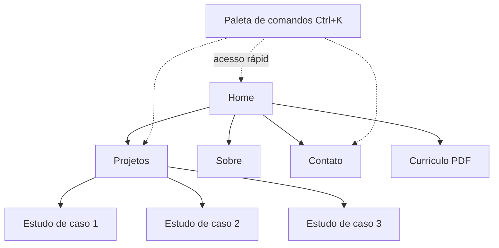

# Portfólio — Jonny Marcus

## Sumário

- [A ideia em uma frase](#a-ideia-em-uma-frase)
- [Para quem o site é feito](#para-quem-o-site-é-feito)
- [Princípios](#princípios)
- [Mapa do site](#mapa-do-site)
- [Home, seção por seção](#home-seção-por-seção)
- [Estudos de caso](#estudos-de-caso)
- [Projetos que eu colocaria em destaque](#projetos-que-eu-colocaria-em-destaque)
- [Credibilidade e conversão](#credibilidade-e-conversão)
- [Identidade visual](#identidade-visual)
- [Interações e animações](#interações-e-animações)
- [Stack](#stack)
- [Qualidade](#qualidade)
- [O que você precisa escrever](#o-que-você-precisa-escrever)
- [Plano de entrega](#plano-de-entrega)
- [Decisões e o porquê](#decisões-e-o-porquê)

---

## A ideia em uma frase

Um site pequeno, rápido e com personalidade, que mostra **poucos projetos bem explicados** em vez de muita coisa superficial, e que leva o visitante a uma ação: **te chamar para conversar**.

## Para quem o site é feito

| Visitante | O que procura | O que o site entrega |
|---|---|---|
| **Recrutador** | Saber quem você é, em que nível está e se serve para a vaga, em menos de 1 minuto | Apresentação objetiva, projetos com resultado, currículo e contato visíveis |
| **Líder técnico** | Ver como você pensa e escreve código | Estudos de caso com decisões, desafios e link para o repositório |
| **Colega de curso ou EJ** | Conhecer seu trabalho | Projetos, jornada e links |

O visitante principal é o recrutador. Se algo não ajuda ele, sai ou vai para o final da fila.

## Princípios

1. **Prova antes de promessa.** Nada de "apaixonado por tecnologia". Projetos, código e decisões falam por você.
2. **Honestidade.** Sem porcentagens de habilidade, sem métricas inventadas. Só dados reais, como os do GitHub.
3. **Poucos projetos, bem contados.** Três ou quatro estudos de caso valem mais que doze cards.
4. **Uma assinatura visual.** Em vez de um efeito em cada seção, um elemento memorável (veja [Identidade visual](#identidade-visual)).
5. **Rápido e acessível.** Um portfólio de dev lento ou quebrado no celular é um mau cartão de visitas.
6. **Fácil de manter.** Atualizar um projeto deve ser editar um arquivo, não mexer em componentes.

## Mapa do site



| Rota | Conteúdo |
|---|---|
| `/` | Resumo de tudo, pensado para ser suficiente sozinho |
| `/projetos` | Lista com filtro por tipo (web, mobile, IA, jogo, acadêmico) |
| `/projetos/[slug]` | Estudo de caso completo |
| `/sobre` | História mais longa, para quem quer saber mais |
| `/contato` | Formulário e contatos diretos |
| `/curriculo` | Currículo em PDF (PT e EN) |

## Home, seção por seção

```text
┌──────────────────────────────────────────────────────────┐
│ <JM />          Projetos  Sobre  Contato    [Currículo]  │
├──────────────────────────────────────────────────────────┤
│  HERO                                                    │
│  Jonny Marcus                                            │
│  Desenvolvedor full stack em formação.                   │
│  Procuro estágio em desenvolvimento (remoto).            │
│  [Ver projetos]  [Falar comigo]                          │
│                                  ┌───────────────────┐   │
│                                  │ cena em pixel art │   │
│                                  └───────────────────┘   │
├──────────────────────────────────────────────────────────┤
│  FATOS RÁPIDOS  Next.js · TS · Remoto · UTC-3 · PT/EN    │
├──────────────────────────────────────────────────────────┤
│  TRABALHOS EM DESTAQUE  (3 a 4 cards grandes)            │
│  [vídeo] Nome · problema em 1 linha · stack · ver caso   │
├──────────────────────────────────────────────────────────┤
│  O QUE USO  (tecnologias ligadas aos projetos)           │
├──────────────────────────────────────────────────────────┤
│  EM CONSTRUÇÃO  (dados reais do GitHub)                  │
├──────────────────────────────────────────────────────────┤
│  SOBRE EM POUCAS LINHAS  + jornada + recomendações       │
├──────────────────────────────────────────────────────────┤
│  CONTATO  (frase direta + e-mail + formulário)           │
└──────────────────────────────────────────────────────────┘
```

| Seção | Objetivo | Detalhes |
|---|---|---|
| **Hero** | Responder em 5 segundos: quem é, o que faz, o que quer | Uma frase de posicionamento, a situação atual (procurando estágio remoto) e dois botões. Nada de rodapé de siglas |
| **Fatos rápidos** | Dar ao recrutador o que ele procura primeiro | Uma linha com stack principal, disponibilidade, fuso, idiomas e botão do currículo |
| **Trabalhos em destaque** | Mostrar prova | Cards grandes com vídeo ou GIF curto, problema em uma linha, tecnologias e link para o estudo de caso |
| **O que uso** | Ser útil ao recrutador que filtra por palavra-chave | Tecnologias agrupadas, cada uma com os projetos em que foi usada (por exemplo, "React Native: Routix"). Sem barras de nível |
| **Em construção** | Mostrar constância | Repositórios recentes e atividade vindos da API do GitHub, com cache. Se a API falhar, a seção some sem quebrar nada |
| **Sobre** | Humanizar | Três ou quatro frases: UNIFEI, Byron Solutions (gestão, processos, finanças), Dev-U e pixel art. A experiência de EJ conta: mostra responsabilidade e trabalho em equipe. Inclui links para recomendações reais do LinkedIn |
| **Contato** | Converter | Convite direto, e-mail clicável e formulário curto |

## Estudos de caso

Cada projeto em destaque tem uma página própria, escrita sempre na mesma ordem:

1. **Resumo em uma frase**, status (em desenvolvimento, concluído, protótipo) e um **vídeo ou GIF de 20 a 30 segundos** do projeto funcionando, logo no topo.
2. **Problema:** quem sofria com o quê.
3. **Minha contribuição:** o que foi parte sua, em especial em projetos de grupo.
4. **Decisões técnicas:** por que essa stack, o que foi descartado e por quê.
5. **Desafio e solução:** o problema mais difícil e como foi resolvido.
6. **Resultado:** o que funciona hoje, o que ficou de fora e o que viria depois.
7. **Aprendizados.**
8. **Links:** repositório (com README completo), demonstração ao vivo e imagens.

O recrutador técnico lê principalmente os itens 3, 4 e 5. É onde você mostra raciocínio, e não só que usou uma ferramenta.

## Projetos que eu colocaria em destaque

Uma sugestão a partir do que você já tem, para você confirmar e ajustar:

| Projeto | Por que entra | Tipo |
|---|---|---|
| **Routix** (app de entregas) | Produto completo, com mapa, GPS, roteirização e decisões de arquitetura para contar | Mobile |
| **CareerFlow AI** | Mostra IA aplicada e sistema multiagente, um assunto que recrutadores procuram | IA |
| **Site da Barbearia do Victor** | Projeto com cliente real, saindo de design no Figma para React/Next.js | Web |
| **O Último Riff** | Mostra criatividade, pixel art e jogo, e conecta com a identidade visual do site | Jogo |

**Entram em uma lista secundária ("Outros trabalhos")**, sem estudo de caso longo: FileManager, PyConverter, VisionAid, EcoItamambuca e os trabalhos acadêmicos.

**DPR AI Office:** é um ótimo case, mas é da Byron. Antes de publicar, confirme o que pode ser mostrado, ou escreva uma versão que explique a arquitetura sem expor dados internos.

## Credibilidade e conversão

Melhorias que transformam um site bonito em um site que **gera conversas**.

| # | Melhoria | Como aplicar |
|---|---|---|
| 1 | **Vídeo ou GIF de 20 a 30 s por projeto** | Gravação de tela curta, sem narração obrigatória, mostrando o fluxo principal. Aparece no card e no topo do estudo de caso. Recrutador raramente lê tudo, mas assiste |
| 2 | **Faixa de fatos rápidos** | Logo abaixo do hero: stack principal, disponibilidade, fuso, idiomas e botão do currículo |
| 3 | **Repositórios alinhados ao site** | Cada estudo de caso aponta para um repositório com README completo (problema, stack, como rodar, capturas). Os repositórios fixados no GitHub são os mesmos projetos em destaque do site |
| 4 | **Mesma mensagem em todo lugar** | A frase de posicionamento e o título profissional iguais no site, LinkedIn, GitHub e currículo |
| 5 | **Teste dos 5 segundos antes de lançar** | Mostrar o hero por 5 segundos a 2 ou 3 pessoas (professor, colega de EJ, alguém da área) e perguntar: "o que ele faz e o que procura?". Se errarem, o hero muda |
| 6 | **Eventos de analytics** | Registrar cliques em "Currículo" e "Contato", downloads do PDF e projetos mais abertos. Revisar após algumas semanas e ajustar o que não converte |
| 7 | **Recomendações reais** | Link para recomendações do LinkedIn de colegas de EJ ou professores, na seção "Sobre". Nunca depoimentos inventados |
| 8 | **Domínio próprio** | Endereço curto e profissional (por exemplo `jonnymarcus.dev`), usado também no currículo e no LinkedIn |
| 9 | **Conteúdo renderizado no servidor** | Todo texto importante sai em HTML, para sistemas de triagem, buscadores e a prévia do LinkedIn funcionarem sem JavaScript |

**Como medir se funciona:** número de contatos recebidos, cliques no currículo e de onde vieram os visitantes. Poucos dados já bastam para decidir o que mudar.

## Identidade visual

Mantém a sua base (escuro com roxo), mas com mais contenção.

| Elemento | Proposta |
|---|---|
| **Tema** | Escuro, com fundo `#080810` e superfícies `#10101C` |
| **Cor principal** | Roxo `#8B35FF`, usado com parcimônia: botões, links, destaques |
| **Cor de apoio** | Azul `#4D8DFF`, só em detalhes pontuais |
| **Texto** | `#F5F5FA` para títulos e `#A5A5B8` para o resto (contraste conferido) |
| **Tipografia** | Space Grotesk nos títulos, Inter no texto e JetBrains Mono em detalhes de código |
| **Assinatura visual** | **Pixel art.** Uma cena no hero e pequenos ícones em pixel nos marcos da jornada. **Começa como imagem estática bem desenhada; a animação entra só depois do lançamento**, para não atrasar o site Vem do seu histórico na Dev-U e diferencia o site de portfólios genéricos em "cyberpunk neon" |
| **Neon** | Só em dois ou três pontos (botão principal, indicador de status, foco). Neon em tudo cansa e prejudica a leitura |
| **Vidro (glassmorphism)** | Opcional e discreto. Cards sólidos leem melhor |

## Interações e animações

A regra: **poucas, com propósito, e desligáveis.**

| Momento | O que acontece | Por quê |
|---|---|---|
| Entrada do hero | Texto aparece em sequência e, numa fase posterior, a cena em pixel art ganha vida | Primeira impressão marcante |
| Rolagem | Seções entram com fade e leve subida | Ritmo de leitura |
| Cards de projeto | Elevação e brilho sutil no hover | Indica que é clicável |
| Jornada | Linha do tempo que se desenha conforme a rolagem | Transforma texto em narrativa |
| **Paleta de comandos (`Ctrl+K`)** | Busca rápida: "projetos", "contato", "currículo", "GitHub" | Substitui o terminal completo: mais útil, mais rápido de fazer e funciona bem com teclado |

- **GSAP** com `ScrollTrigger` e `@gsap/react`, apenas nos momentos acima.
- Só `transform` e `opacity`.
- Com `prefers-reduced-motion`, as animações viram fades simples ou ficam desligadas.
- Em celular, sem efeitos de mouse.

## Stack

| Tecnologia | Uso |
|---|---|
| Next.js (App Router) + TypeScript | Base do site |
| Tailwind CSS | Estilo, com a paleta como tokens |
| MDX | Estudos de caso escritos como arquivos de texto |
| GSAP | Animações selecionadas |
| Canvas ou sprites CSS | Cena em pixel art |
| API do GitHub (rota de servidor + cache) | Seção "Em construção" |
| Zod + Resend | Formulário de contato validado |
| Vercel Analytics ou Plausible | Eventos: cliques em currículo e contato, projetos mais abertos (sem cookies) |
| Domínio próprio | Endereço profissional, usado no currículo e no LinkedIn |
| Vitest e Playwright | Testes dos pontos críticos |
| GitHub Actions + Vercel | Integração contínua e hospedagem |

## Qualidade

- **Desempenho:** Lighthouse 90+ em todas as categorias; imagens com `next/image`, fontes com `next/font`, GSAP carregado sob demanda.
- **Acessibilidade:** navegação por teclado, foco visível, contraste verificado, textos alternativos, HTML semântico.
- **Renderização no servidor:** todo o conteúdo importante sai em HTML, para triagem automática, buscadores e a prévia do LinkedIn funcionarem sem JavaScript.
- **SEO e compartilhamento:** metadados por página, imagem Open Graph por projeto, `sitemap`, `robots`, dados estruturados `Person`.
- **Privacidade:** analytics sem cookies e sem dados pessoais; eventos só de cliques e navegação. Nada de visitante guardado além do necessário para responder o formulário.
- **Idiomas:** português primeiro e inglês depois, com currículo nos dois, já que a busca é por vagas remotas.
- **Falhas:** página 404 própria e seções que dependem de API (GitHub) falham em silêncio, sem quebrar a página.

## O que você precisa escrever

O código é a parte mais previsível. O que decide o resultado é o conteúdo. Para cada projeto em destaque, responda:

- Qual problema ele resolve, e para quem?
- O que **você** fez, especificamente?
- Qual foi a decisão técnica mais difícil, e o que você descartou?
- O que funciona hoje e o que ainda falta?
- Existe link de repositório, demonstração ou capturas de tela?
- Você tem (ou pode gravar) um vídeo ou GIF de 20 a 30 segundos mostrando o projeto funcionando?
- O README do repositório está completo e bate com o estudo de caso?

Itens gerais:

- **Frase de posicionamento** do hero (uma linha, sem clichê), igual à do LinkedIn, do GitHub e do currículo.
- **Texto do "Sobre"** (3 a 4 frases).
- **Fatos rápidos:** stack principal, disponibilidade, fuso e idiomas.
- **Currículo atualizado**, em PDF.
- **Recomendações:** peça 2 ou 3 no LinkedIn a colegas de EJ ou professores.
- **Domínio:** escolha o nome do endereço.

## Plano de entrega

| Etapa | Entrega | Resultado |
|---|---|---|
| 1 | Projeto Next.js, tokens de tema, layout, hero, fatos rápidos e contato com e-mail | Base no ar, com o essencial |
| 2 | Home completa, **um** estudo de caso (o melhor, com vídeo), domínio próprio, frase de posicionamento alinhada com LinkedIn, GitHub e currículo, **teste dos 5 segundos** | **Publicar.** Já pode ir no currículo e nas candidaturas |
| 3 | Demais estudos de caso com vídeo, README dos repositórios fixados, "Outros trabalhos", recomendações do LinkedIn | Portfólio completo e coerente |
| 4 | Seção do GitHub, formulário com anti-spam, SEO, imagens Open Graph, **eventos de analytics** | Produto polido e mensurável |
| 5 | Animações com GSAP, paleta `Ctrl+K` e, por último, a animação da cena em pixel art | Personalidade |
| 6 | Versão em inglês, testes e CI. Opcional: um post sobre o que aprendeu construindo o Routix | Maturidade |
| Contínuo | Revisar os dados de analytics e ajustar o hero e os cards que não convertem | Melhoria baseada em dados |

**Importante:** publicar na etapa 2. Um site simples e no ar ajuda mais que um site perfeito que nunca fica pronto.

## Decisões e o porquê

| Decisão | Motivo |
|---|---|
| Menos seções que um portfólio "completo" | Cada seção compete pela atenção do recrutador |
| Estudos de caso em vez de só cards | É onde se vê raciocínio, que é o que diferencia candidatos juniores |
| Pixel art como assinatura | É autêntico, vem do seu histórico e ninguém confunde com template |
| Paleta `Ctrl+K` no lugar do terminal | Mesma ideia de "interface de dev", mas útil de verdade e melhor no celular |
| Tecnologias ligadas a projetos | Prova de uso e atende a busca por palavras-chave |
| Neon contido | Legibilidade e aparência profissional |
| Publicar cedo | O conteúdo melhora iterando, e a vaga não espera |
| Vídeo curto por projeto | Mostra o produto funcionando em segundos e convence mais que texto |
| Fatos rápidos no topo | Responde primeiro ao que o recrutador procura |
| Repositórios alinhados ao site | Site bonito com repositório vazio perde credibilidade |
| Mesma mensagem em todos os canais | Consistência passa profissionalismo e facilita a busca por você |
| Teste dos 5 segundos | Valida o hero com pessoas reais antes de lançar |
| Analytics de eventos | Permite melhorar com dados em vez de achismo |
| Recomendações reais | Prova social sem inventar depoimento |
| Pixel art estática primeiro | A animação é a parte mais arriscada em prazo; não deve atrasar a publicação |
| Blog só opcional | Um blog parado prejudica mais do que ajuda |

---

<p align="center"><b>Jonny Marcus — Portfólio</b></p>
