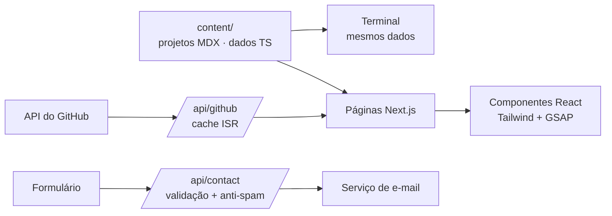

# 🚀 Jonny Marcus — Developer Portfolio

<p align="center">
  
</p>

<h3 align="center">Portfólio profissional | Full Stack Developer</h3>

<p align="center">
  
  
  
  
</p>

<p align="center">
  🔗 <b>Demo:</b> <a href="https://SEU-DOMINIO.com">SEU-DOMINIO.com</a> ·
  💼 <a href="https://linkedin.com/in/SEU-PERFIL">LinkedIn</a> ·
  🐙 <a href="https://github.com/JonnyMarcus">GitHub</a>
</p>

---

## Sumário

- [Sobre o projeto](#sobre-o-projeto)
- [Status das funcionalidades](#status-das-funcionalidades)
- [Identidade visual](#identidade-visual)
- [Funcionalidades](#funcionalidades)
- [Animações com GSAP](#animações-com-gsap)
- [Qualidade: desempenho, acessibilidade e SEO](#qualidade-desempenho-acessibilidade-e-seo)
- [Arquitetura e conteúdo](#arquitetura-e-conteúdo)
- [Stack](#stack)
- [Estrutura do projeto](#estrutura-do-projeto)
- [Como rodar](#como-rodar)
- [Testes e CI](#testes-e-ci)
- [Roadmap](#roadmap)

---

## Sobre o projeto

Portfólio pessoal interativo que funciona como um **currículo digital**: apresenta minha trajetória acadêmica, experiências, habilidades técnicas e projetos, para que recrutadores, desenvolvedores e empresas conheçam meu perfil de forma dinâmica e organizada.

A identidade visual é futurista, inspirada em interfaces tecnológicas: Dark UI, neon roxo, elementos Cyberpunk e animações suaves.

### 🎯 Objetivos

- Apresentar minha trajetória como estudante de Ciência da Computação.
- Demonstrar minhas habilidades em desenvolvimento de software.
- Exibir projetos pessoais, acadêmicos e profissionais com contexto técnico.
- Centralizar minhas informações profissionais.
- Facilitar o contato com recrutadores e empresas.
- Servir como prova de conhecimento: o próprio site é um projeto real, com boas práticas de engenharia.

> **Princípio do projeto:** o README só promete o que existe. Cada funcionalidade tem um status na tabela abaixo.

## Status das funcionalidades

| Funcionalidade | Status |
|---|---|
| Hero | ⬜ |
| Sobre mim | ⬜ |
| Tecnologias e ferramentas | ⬜ |
| Projetos em destaque | ⬜ |
| Páginas individuais de projetos | ⬜ |
| Minha jornada (timeline) | ⬜ |
| GitHub Activity | ⬜ |
| Atualmente estudando | ⬜ |
| Terminal interativo | ⬜ |
| Contato | ⬜ |
| Versão em inglês | ⬜ |

Legenda: ✅ pronto · 🚧 em andamento · ⬜ planejado. *Atualize a tabela a cada entrega.*

---

# 🎨 Identidade visual

### Características

- Interface Dark Mode com detalhes em neon roxo.
- Efeitos de iluminação e cards com Glassmorphism.
- Elementos visuais inspirados em código.
- Animações suaves e microinterações.
- Layout responsivo, pensado primeiro para celular.

### Paleta de cores

| Cor | Código | Utilização |
|---|---|---|
| Preto | `#080810` | Fundo principal |
| Cinza escuro | `#10101C` | Cards e painéis |
| Roxo | `#8B35FF` | Cor principal |
| Roxo claro | `#B56CFF` | Destaques |
| Azul | `#4D8DFF` | Elementos complementares |
| Branco | `#F5F5FA` | Textos principais |
| Cinza | `#A5A5B8` | Textos secundários |

As cores ficam como **tokens no Tailwind** (`background`, `surface`, `primary`, `primary-light`, `accent`, `foreground`, `muted`), nunca como valores soltos nos componentes. Assim, mudar o tema é editar um arquivo.

---

# 🧩 Funcionalidades

## 1. Página inicial (Hero)

- Nome, apresentação, especialização e interesses.
- Indicador de **disponibilidade para oportunidades**, controlado por uma configuração (não fixo no código).
- Personagem ilustrado.
- Botões: ver projetos e baixar currículo.
- Links para GitHub e LinkedIn.

## 2. Sobre mim

- Estudante de Ciência da Computação na UNIFEI.
- Atuação na empresa júnior Byron Solutions.
- Experiência anterior na Dev-U.
- Interesses em desenvolvimento de software e objetivos profissionais.

## 3. Tecnologias e ferramentas

Cards com ícones, organizados por categoria. **Sem porcentagens artificiais de proficiência.**

| Categoria | Tecnologias |
|---|---|
| **Frontend** | HTML5, CSS3, JavaScript, TypeScript, React, Next.js, Tailwind CSS |
| **Backend** | Node.js, Python, C, C# |
| **Ferramentas** | Git, GitHub, VS Code, Figma, Blender, Power BI, Make |

Os dados vêm de um arquivo de conteúdo, então adicionar uma tecnologia não exige mexer nos componentes.

## 4. Projetos em destaque

Galeria de projetos. Cada card mostra: nome, capa, descrição curta, tecnologias, minha contribuição, link do GitHub e demonstração (quando houver). Filtro por tecnologia ou tipo (web, mobile, jogo, acadêmico).

| Projeto | Descrição |
|---|---|
| Patrus Sync | Sistema de roteirização e organização de entregas |
| Barber Scheduling | Gerenciamento e agendamento para barbearias |
| O Último Riff | Jogo com pixel art e narrativa |
| Estudos e experimentos | Projetos acadêmicos e experimentos de programação |

## 5. Páginas individuais dos projetos

Cada projeto tem uma página própria, escrita como um **estudo de caso**:

1. Visão geral e problema identificado.
2. Objetivos e funcionalidades.
3. Minha contribuição (importante em projetos de grupo).
4. Arquitetura e estrutura do projeto.
5. Desafios técnicos e soluções.
6. **Resultados** (o que funcionou, o que foi medido, o que ficou de fora).
7. Aprendizados.
8. Imagens, demonstrações e link do repositório.

```text
/projetos
/projetos/patrus-sync
/projetos/barber-scheduling
/projetos/o-ultimo-riff
```

O conteúdo é escrito em MDX, e as rotas são geradas a partir dos arquivos.

## 6. Minha jornada

Timeline interativa com os marcos da minha evolução:

- **2024:** ingresso na UNIFEI e início da graduação em Ciência da Computação.
- **2025:** projetos de desenvolvimento de jogos e atividades na Dev-U.
- **2026:** entrada na Byron Solutions, atuando em atividades administrativas, financeiras e organizacionais.

## 7. GitHub Activity

Integração com a API pública do GitHub (`github.com/JonnyMarcus`), com informações reais e nenhuma métrica inventada: foto, usuário, biografia, repositórios públicos, projetos recentes, linguagens e histórico de contribuições quando disponível.

**Como é feito corretamente**

- As chamadas passam por uma **rota do servidor** (`/api/github`), não pelo navegador. Isso protege o token e evita estourar o limite de requisições da API.
- Resposta com **cache e revalidação** (ISR), em vez de buscar a cada visita.
- Indicadores de carregamento (skeleton) e tratamento de erro com mensagem amigável.
- Se a API falhar, o site continua mostrando o último resultado em cache.
- Link para o perfil completo.

## 8. Atualmente estudando

Tópicos em andamento: TypeScript, React e Next.js, Node.js, estruturas de dados, algoritmos, arquitetura de software e Inteligência Artificial.

Cada item fica em um arquivo de conteúdo, para ser adicionado ou removido facilmente.

## 9. Terminal interativo

Terminal visual inspirado em Linux, no qual o visitante conhece o desenvolvedor por comandos.

| Comando | Funcionalidade |
|---|---|
| `help` | Lista os comandos disponíveis |
| `about` | Informações pessoais |
| `projects` | Lista os projetos |
| `skills` | Apresenta as tecnologias |
| `experience` | Mostra as experiências profissionais |
| `contact` | Mostra as formas de contato |
| `github` | Abre o perfil do GitHub |
| `resume` | Baixa o currículo |
| `clear` | Limpa o terminal |

Detalhes que fazem diferença:

- Histórico com as setas ↑ ↓ e autocompletar com `Tab`.
- Mensagem amigável para comando desconhecido, sugerindo `help`.
- Os comandos usam os **mesmos arquivos de conteúdo** do restante do site, sem duplicar texto.
- Pequenos *easter eggs* para visitantes curiosos.
- **Em celular**, botões com os comandos principais, já que digitar é ruim em telas pequenas.
- Acessível: funciona só com teclado e é compatível com leitores de tela.

## 10. Contato *(novo)*

Hoje o visitante só encontra links. A seção de contato fecha o objetivo "facilitar o contato com recrutadores":

- Formulário com nome, e-mail e mensagem, validado no cliente e no servidor.
- Envio por rota do servidor (`/api/contact`) com serviço de e-mail.
- Proteção contra spam (campo oculto *honeypot* e limite de envios por IP).
- Mensagens claras de sucesso e erro.
- E-mail, LinkedIn e GitHub em destaque, para quem prefere contato direto.

---

# ✨ Animações com GSAP

As animações reforçam a identidade futurista e guiam o olhar do visitante, mas **nunca atrapalham a leitura nem o desempenho**. Cada uma tem um motivo.

## Catálogo de animações

| Onde | Animação | Técnica |
|---|---|---|
| **Entrada do site** | Tela de carregamento curta com a marca em neon, que se dissolve revelando o Hero | `gsap.timeline()` |
| **Hero: título** | Texto revelado por linhas ou palavras, com leve deslocamento e fade | `SplitText` + timeline com `stagger` |
| **Hero: personagem** | Flutuação suave e leve **parallax** seguindo o mouse (no celular, o giroscópio fica de fora) | `gsap.quickTo` + `mousemove` |
| **Hero: indicador de disponibilidade** | Pulso neon contínuo e discreto | `repeat: -1`, `yoyo` |
| **Seções ao rolar** | Elementos entram com fade e subida suave quando aparecem na tela | `ScrollTrigger` |
| **Tecnologias** | Cards entram em cascata; no hover, brilho roxo e leve elevação | `stagger` + `gsap.to` no hover |
| **Projetos** | Cards em cascata, efeito de inclinação 3D no hover e imagem com zoom suave | `ScrollTrigger` + hover com `quickTo` |
| **Minha jornada** | Timeline **fixada na tela** (`pin`) enquanto a linha neon se desenha e cada marco acende conforme a rolagem | `ScrollTrigger` com `scrub` e `pin` |
| **GitHub Activity** | Barras de linguagens e contadores animados até os valores reais | `gsap.to` com `snap` |
| **Atualmente estudando** | Itens aparecem um a um, com barra de destaque deslizando | timeline com `stagger` |
| **Terminal** | Efeito de digitação nas respostas e cursor piscando | timeline simples ou `TextPlugin` |
| **Botões e links** | Efeito magnético leve (o botão acompanha o cursor) e brilho que percorre a borda | `quickTo` |
| **Troca de páginas** | Transição com cortina neon ao entrar em um projeto | timeline no `layout` |
| **Fundo** | Partículas ou grade com brilho em baixa intensidade, que reage ao scroll | CSS + `ScrollTrigger` |

> Contadores só animam **valores reais** (por exemplo, repositórios públicos vindos da API). Nada de números inventados.

## Princípios

1. **Só `transform` e `opacity`.** Animar `top`, `width` ou `box-shadow` pesado causa travamentos em celulares intermediários.
2. **Respeitar `prefers-reduced-motion`.** Com a preferência ativa, as animações viram simples fades ou ficam desligadas.
3. **Menos no celular.** Efeitos de mouse (parallax, magnético, cursor) existem só em telas com ponteiro; em telas pequenas, versões mais leves.
4. **Animação não esconde conteúdo.** Se o JavaScript falhar, o texto continua visível (o estado inicial "escondido" é aplicado pelo GSAP, não pelo CSS).
5. **Duração curta e consistente.** Entradas entre 0,4 s e 0,8 s, com poucas curvas de easing padronizadas.
6. **Limpeza obrigatória.** Toda animação é desfeita quando o componente sai da tela, para evitar vazamento de memória.

## Como integrar com Next.js e React

- Usar o pacote **`@gsap/react`** e o hook **`useGSAP`**, que cria e limpa as animações automaticamente junto com o ciclo de vida do componente.
- Registrar os plugins (`ScrollTrigger`, `SplitText`, `TextPlugin`) **uma única vez**, em `src/lib/gsap.ts`.
- Componentes animados são **Client Components** (`"use client"`), mantendo o restante do site no servidor.
- Usar `gsap.matchMedia()` para separar regras de desktop, celular e `prefers-reduced-motion` em um só lugar.
- Carregar o GSAP com **`dynamic import`** nas seções abaixo da dobra, para não pesar o primeiro carregamento.
- Escopar os seletores com `scope` (a `ref` do componente), em vez de buscar classes na página inteira.

```text
src/lib/gsap.ts              # registra plugins e define easings padrão
src/hooks/useReveal.ts       # animação de entrada reutilizável
src/hooks/useMagnetic.ts     # efeito magnético para botões
src/components/animations/   # <Reveal>, <SplitTitle>, <PageTransition>
```

**Opcional:** suavização de rolagem com **Lenis**, integrada ao `ScrollTrigger`, para uma sensação mais fluida. Deve ser desligada quando `prefers-reduced-motion` estiver ativo.

# ✅ Qualidade: desempenho, acessibilidade e SEO

Como o público inclui recrutadores técnicos, o site precisa **ser** o que diz saber fazer.

### Desempenho

- Meta: Lighthouse **90+** em desempenho, acessibilidade, boas práticas e SEO.
- Imagens com `next/image` e fontes com `next/font`.
- Carregamento sob demanda (`dynamic import`) de GSAP, do terminal e de seções pesadas.
- Animações usando apenas `transform` e `opacity`, para manter 60 fps em celulares intermediários (veja [Animações com GSAP](#animações-com-gsap)).

### Acessibilidade

- Respeito a `prefers-reduced-motion`: animações desligadas ou reduzidas.
- Navegação completa por teclado, com foco visível.
- Contraste conferido nas combinações de cor do tema.
- Texto alternativo em imagens, HTML semântico e rótulos nos campos.
- O terminal e a timeline têm alternativa textual simples.

### SEO e compartilhamento

- Metadados por página (título, descrição) e imagem Open Graph gerada por projeto.
- `sitemap.xml` e `robots.txt` gerados pelo Next.js.
- Dados estruturados (JSON-LD `Person`).
- Página 404 personalizada e `error boundary` para falhas inesperadas.

### Privacidade

- Analytics sem cookies (por exemplo Vercel Analytics ou Plausible) para saber quais projetos chamam mais atenção.
- Nenhum dado pessoal de visitantes guardado além do necessário para responder o formulário.

### Idiomas

- Português (Brasil) como idioma principal.
- Versão em **inglês** planejada, com currículo nos dois idiomas, para vagas internacionais e remotas.

---

# 🗂️ Arquitetura e conteúdo

O site é **orientado a conteúdo**: textos, projetos, habilidades e jornada ficam em arquivos próprios, separados dos componentes. Para publicar um novo projeto, basta criar um arquivo MDX.



Exemplo de cabeçalho de um projeto:

```yaml
---
slug: patrus-sync
title: Patrus Sync
summary: Sistema de roteirização e organização de entregas
type: mobile
stack: [React Native, TypeScript, SQLite]
repo: https://github.com/JonnyMarcus/...
demo: null
featured: true
---
```

## Stack

| Tecnologia | Uso |
|---|---|
| Next.js (App Router) | Framework, rotas e rotas de API |
| TypeScript | Tipagem em todo o projeto |
| Tailwind CSS | Estilização com tokens de tema |
| GSAP + `@gsap/react` | Animações, timelines e integração com React |
| ScrollTrigger, SplitText | Animações ligadas à rolagem e ao texto |
| Lenis (opcional) | Rolagem suave |
| MDX | Páginas de projetos |
| Zod | Validação do formulário |
| Resend ou Formspree | Envio de e-mails |
| Vitest + Testing Library | Testes unitários e de componentes |
| Playwright | Testes de ponta a ponta |
| ESLint + Prettier | Padronização do código |
| GitHub Actions | Integração contínua |
| Vercel | Hospedagem |

## Estrutura do projeto

```text
portfolio/
├── public/
│   ├── images/
│   └── curriculo/            # PDFs (PT e EN)
├── content/
│   ├── projects/             # um .mdx por projeto
│   ├── skills.ts
│   ├── journey.ts
│   └── studying.ts
├── src/
│   ├── app/
│   │   ├── layout.tsx
│   │   ├── page.tsx
│   │   ├── projetos/
│   │   │   ├── page.tsx
│   │   │   └── [slug]/page.tsx
│   │   ├── api/
│   │   │   ├── github/route.ts
│   │   │   └── contact/route.ts
│   │   ├── sitemap.ts
│   │   ├── robots.ts
│   │   ├── opengraph-image.tsx
│   │   └── not-found.tsx
│   ├── components/
│   │   ├── hero/
│   │   ├── about/
│   │   ├── skills/
│   │   ├── projects/
│   │   ├── journey/
│   │   ├── github/
│   │   ├── studying/
│   │   ├── terminal/
│   │   ├── contact/
│   │   ├── animations/       # Reveal, SplitTitle, PageTransition
│   │   └── ui/
│   ├── lib/
│   │   ├── gsap.ts           # registro de plugins
│   │   ├── github.ts
│   │   ├── content.ts
│   │   └── terminal/commands.ts
│   └── hooks/                # useReveal, useMagnetic
├── tests/
│   ├── unit/
│   └── e2e/
├── .env.example
├── tailwind.config.ts
├── next.config.mjs
└── README.md
```

## Como rodar

**Pré-requisitos:** Node.js 20+ e npm (ou pnpm).

```bash
git clone https://github.com/JonnyMarcus/<repositorio>.git
cd <repositorio>
npm install

cp .env.example .env.local   # preencha as variáveis abaixo
npm run dev
```

Acesse `http://localhost:3000`.

### Variáveis de ambiente

| Variável | Para quê | Obrigatória |
|---|---|---|
| `NEXT_PUBLIC_SITE_URL` | URL do site (SEO e sitemap) | Sim |
| `GITHUB_USERNAME` | Usuário usado na integração | Sim |
| `GITHUB_TOKEN` | Aumenta o limite da API do GitHub | Recomendada |
| `RESEND_API_KEY` | Envio do formulário de contato | Para o contato |
| `CONTACT_TO_EMAIL` | E-mail que recebe as mensagens | Para o contato |

Nunca versione o `.env.local`.

### Scripts

| Comando | O que faz |
|---|---|
| `npm run dev` | Servidor de desenvolvimento |
| `npm run build` | Build de produção |
| `npm run start` | Roda o build |
| `npm run lint` | Verifica o código |
| `npm run typecheck` | Checa os tipos |
| `npm run test` | Testes unitários |
| `npm run e2e` | Testes de ponta a ponta |

## Testes e CI

- **Unitários:** comandos do terminal, validação do formulário e tratamento da resposta do GitHub.
- **Ponta a ponta:** navegação principal, abertura de uma página de projeto e envio do formulário.
- **GitHub Actions:** a cada push, roda lint, typecheck, testes e build. Um selo de status no topo do README mostra se está passando.
- **Lighthouse CI** opcional, para não deixar o desempenho cair sem perceber.

## Roadmap

| Etapa | Foco | Entregas |
|---|---|---|
| 1 | **Base** | Projeto Next.js, tokens de tema, layout, Hero e Sobre |
| 2 | **Conteúdo** | Tecnologias, jornada e "atualmente estudando", todos orientados a dados |
| 3 | **Projetos** | Galeria, filtros e páginas de estudo de caso em MDX |
| 4 | **Integrações** | GitHub Activity com rota de servidor e cache |
| 5 | **Interatividade e animações** | Terminal interativo; intro e Hero animados; revelações com ScrollTrigger; timeline fixada na jornada; hover dos cards; transição entre páginas |
| 6 | **Contato** | Formulário com validação, anti-spam e envio de e-mail |
| 7 | **Qualidade** | SEO, Open Graph, acessibilidade, 404, testes e CI |
| 8 | **Publicação** | Deploy na Vercel, domínio próprio e analytics |
| 9 | **Evolução** | Versão em inglês, blog ou notas técnicas, novos estudos de caso |

---

<p align="center"><b>Jonny Marcus — Developer Portfolio</b></p>
